  

# 🌐 Awesome Contingent Workforce Management (CWM & VMS)

  
  
  
  
  
  
  

> **Top Contingent Workforce Management (Open-Source & Enterprise SaaS) 🌟 Star if you like it! 🌟**
>
> *A comprehensive, SEO-optimized curated index of **Vendor Management Systems (VMS)**, **Statement of Work (SOW)** lifecycle tools, **contractor compliance platforms**, **freelancer management systems (FMS)**, and **open-source workforce automation infrastructure**.*
>
> **Last updated: October 2026**

---

This curated repository tracks industry-leading **enterprise SaaS platforms** and **open-source GitHub projects** designed for **Contingent Workforce Management (CWM)**, **Extended Workforce Operations**, and **Services Procurement**. Organizations use these technologies to automate sourcing, onboarding, worker classification, shift scheduling, time and billing, invoice reconciliation, and compliance governance for non-employee workers (independent contractors, freelancers, gig workers, and temp agency staff).

## 📑 Table of Contents

- [📈 Sector Overview & Market Dynamics](#-sector-overview--market-dynamics)
- [🏢 SaaS / Hosted Enterprise Platforms](#-saas--hosted-enterprise-platforms)
- [💻 Open-Source GitHub Projects](#-open-source-github-projects)
  - [Top Open-Source Workforce & Vendor Platforms](#top-open-source-workforce--vendor-platforms)
  - [Adjacent HRMS & Applicant Tracking Solutions](#adjacent-hrms--applicant-tracking-solutions)
- [🛠️ Frameworks for Custom CWM Architectures](#️-frameworks-for-custom-cwm-architectures)
- [🤝 How to Contribute](#-how-to-contribute)
- [⭐ Star History](#-star-history)
- [💖 Support & Sponsorship](#-support--sponsorship)
- [⚠️ Disclaimer](#️-disclaimer)

---
## 📈 Sector Overview & Market Dynamics

The global **Contingent Workforce Management (CWM)** software and **Vendor Management System (VMS)** market is valued at approximately **$1.0B to $1.3B** in pure software spend, orchestrating a broader non-employee labor, Managed Service Provider (MSP), and external payroll ecosystem managing over **$180B to $200B+** in annual gross spend globally.

The sector demonstrates a distinctive structural market dynamic:
- **Core Enterprise VMS Software (Moderately Concentrated / Oligopolistic):** Enterprise buyer demand centers around a small oligopoly of proven, deeply integrated suites—chiefly **SAP Fieldglass**, **Workday / VNDLY**, **Coupa**, **Beeline**, and **Magnit**—which govern the lion's share of Fortune 500 contingent spend.
- **Wider Contingent Services & Sourcing Layer (Highly Fragmented):** Outside the core VMS technology layer, the broader ecosystem of staffing suppliers, independent contractor compliance agencies (AOR/EOR), niche direct-sourcing portals, and regional Managed Service Providers remains **highly fragmented**, continuously driving the requirement for centralizing software.

---
## 🏢 SaaS / Hosted Enterprise Platforms

| Platform | Company Size (Revenue / Valuation) | Pricing (Specific Starting Tiers) | Free Tier / Trial Limits | Key Capabilities & Best For |
| :--- | :--- | :--- | :--- | :--- |
| **[SAP Fieldglass](https://www.fieldglass.com/)** | **~$265B Market Cap** (~€36.8B / $42.4B annual revenue) | Tiered spend/volume pricing starting at **0.7% to 0.9% of managed contingent labor spend**; custom enterprise licensing for dual CWM and Services Procurement (SOW) modules. | **No public self-serve free trial**; access restricted to guided sales demos, interactive product tours, or tenant sandboxes via SAP PartnerEdge. | Enterprise services procurement & contingent workforce management; best for SAP-centric organizations deeply integrating S/4HANA & SuccessFactors. |
| **[Workday Contingent Workforce Management](https://www.workday.com/)** | **~$50B Market Cap** ($9.552B FY2026 revenue) | Module pricing starting at **~$35 to $45 PEPM** (per employee/contingent worker per month) at enterprise volume, or baseline core suite contracts starting at **~$100,000/year**. | **No self-serve free trial** for core HCM/CWM; click-through interactive guided workflows available on demand; 30-day trials offered solely for Workday Adaptive Planning. | Native contingent workforce tracking, worker lifecycle, and onboarding integrated directly within the Workday HCM & Financials suite. |
| **[VNDLY (Workday)](https://www.workday.com/)** | **~$50B Parent Market Cap** (Acquired for $510M by Workday; $9.552B parent revenue) | Tiered pricing starting at **$15 to $45 per worker/month** or **0.5% to 2.5% of managed contingent spend** based on total program volume. | **No self-serve free trial**; evaluation conducted via structured sales-led sandboxes and guided proof-of-concept demos. | Cloud-native VMS for managing contractors, SOW engagements, and gig workers; best for enterprises seeking unified extended workforce and HCM orchestration. |
| **[Coupa Contingent Workforce](https://www.coupa.com/)** | **$8.0B Valuation** (Acquired by Thoma Bravo; ~$818M annual revenue) | Contingent workforce / services procurement module contracts starting at **~$15,000 to $50,000/year** for basic entry-level BSM deployments. | **30-day free trial** available exclusively for suppliers on the Coupa Supplier Portal (CSP Coupa Advanced); buyer enterprise VMS requires scheduled custom sales demo. | Comprehensive contingent labor and SOW spend management unified with source-to-pay and business spend management (BSM). |
| **[Upwork Enterprise](https://www.upwork.com/enterprise)** | **~$1.2B Market Cap** ($787.8M 2025 revenue) | **Basic Client Tier: Free** platform access + 5% client service fee on payments; **Business Plus: 10% fee**; **Enterprise: Custom annual contract** based on compliance/EOR scope + negotiated fee markup. | **Permanent free plan** on Upwork Basic ($0 recurring platform fee, pay-per-contract with 5% marketplace fee); Enterprise tier offers no self-serve free trial. | Global freelance and contractor sourcing with enterprise-grade classification compliance, consolidated invoicing, and talent pool curation. |
| **[Magnit](https://magnitglobal.com/)** | **~$500M - $1.0B+ Revenue** (Majority owned by EQT Private Equity; backed by $1.16B+ credit facilities) | Custom spend-based volume fee (typically **1.0% to 2.5% of total contingent labor spend** or tiered worker volume fees). | **No self-serve free trial**; access is exclusively sales-led via customized product discovery demos. | Full-spectrum extended workforce platform combining enterprise VMS, MSP, Direct Sourcing, and EOR/compliance operations. |
| **[Beeline](https://www.beeline.com/)** | **~$150M - $200M Revenue** (Majority owned by Stone Point Capital; handles $68B+ contingent spend) | Enterprise VMS contracts starting at **~$100,000/year** (or supplier connection plans via Beeline Supplier Network starting at **$2,500/year**). | **30-day free trial** available exclusively for staffing agencies on the Beeline Supplier Network (BSN); core buyer VMS has no free trial and is demo-only. | Extended workforce and VMS leader with SOW management, direct sourcing, and MBO Partners integration; best for organizations managing 50+ external workers. |
| **[VectorVMS](https://www.vectorvms.com/)** | **$50M Valuation** (Acquired by PIXID Group in 2024; $11.4M annual revenue) | Enterprise mid-market subscriptions starting from **custom quote tied to managed spend / headcount tiers** (historical mid-market baselines ~**$12,000 to $25,000/year**). | **No self-serve free trial**; prospective clients can request a personalized live interactive demo. | Dedicated, configurable vendor management system for mid-market to enterprise programs without mandatory MSP overhead. |
| **[Utmost](https://www.utmost.com/)** | **~$33M Total VC Funding** (Acquired by Beeline in 2022; backed by Greylock and Workday Ventures) | Custom usage-based pricing scaled by external worker headcount under management (now bundled into Beeline extended workforce solutions). | **No self-serve free trial**; evaluation is available via tailored demos through Beeline. | Extended workforce system emphasizing worker classification, front-door contractor onboarding, and extended workforce analytics. |
| **[Flextrack](https://www.flextrack.com/)** | **$2B+ Managed Spend** (Subsidiary of GSGroup; seed/venture backed by Accelerace) | Enterprise licensing based on managed spend percentage (typically **0.5% to 1.5%**) or custom Salesforce platform user licensing. | **No self-serve free trial**; custom enterprise sandbox demonstrations offered upon consultation. | Salesforce-native vendor management system with talent pooling, direct sourcing, and workflow automation. |

---
## 💻 Open-Source GitHub Projects

> **Note on Open-Source Contingent Workforce Software**: Dedicated enterprise-grade open-source VMS platforms (replicating full Beeline or SAP Fieldglass architectures with global MSP governance and multi-tier supplier networks) do not currently exist as turnkey solutions. The open-source repositories below represent the strongest building blocks available: full-featured ERP/vendor platforms, contractor time and invoicing engines, gig worker shift platforms, freelance marketplaces, and vendor management REST APIs.

### Top Open-Source Workforce & Vendor Platforms

All open-source repositories below are ordered in **descending order by GitHub star count**:

-  **[ERPNext](https://github.com/frappe/erpnext)** — **The world's leading open-source ERP system** (GPL-3.0) with comprehensive Supplier/Vendor Management, Purchase Orders, Subcontracting workflows, Timesheets, Contractor Billing, and Project Accounting. Includes a full supplier portal for self-service invoice uploads and quotation management. **Tech stack**: Python (Frappe Framework), MariaDB, JavaScript, Redis. **Best for**: organizations seeking an end-to-end self-hosted platform to orchestrate supplier lifecycles, contractor purchase orders, and timesheets.

-  **[Invoice Ninja](https://github.com/invoiceninja/invoiceninja)** — **Enterprise-grade open-source invoicing, contractor payment, and expense tracking platform** (Source-available / Elastic License 2.0). Features robust vendor records, custom purchase orders, contractor timesheets linked directly to project billing, and client/contractor portals. **Tech stack**: Laravel (PHP), Flutter, MySQL. **Best for**: businesses managing direct contractor invoicing, vendor bills, and milestone project payments.

-  **[Ever Gauzy](https://github.com/ever-co/ever-gauzy)** — **Open-source business management and contractor workforce platform** (AGPL-3.0) purpose-built for modern remote, on-demand, and contingent staffing operations. Includes employee & contractor time tracking, screenshots/activity tracking, payroll calculation, vendor management, and candidate pipelines. **Tech stack**: NestJS (Node.js), Angular, TypeScript, PostgreSQL. **Best for**: agencies and digital enterprises coordinating remote contract workers, tracking billable hours, and calculating contractor payouts.

-  **[Crater](https://github.com/crater-invoice-inc/crater)** — **Open-source invoicing and vendor tracking application** (GPL-3.0) designed for freelancers and small teams. Manages supplier and contractor profiles, itemized estimates, milestone invoicing, and payment reconciliation with web and mobile clients. **Tech stack**: Laravel (PHP), Vue.js, React Native. **Best for**: lean organizations wanting a minimalist, self-hosted vendor invoice and payment logging solution.

-  **[Horilla HRMS](https://github.com/horilla/horilla-hr)** — **Open-source Human Resource Management software** (LGPL-2.1) providing recruitment pipelines, worker record repositories, attendance, leave, and payroll processing. **Tech stack**: Python (Django), HTML5, JavaScript. **Best for**: centralized workforce records that can be extended to track internal and non-employee worker directories.

-  **[MintHCM](https://github.com/minthcm/minthcm)** — **Open-source Human Capital Management platform** (AGPL-3.0) built on SugarCRM/SuiteCRM architecture. Manages staffing pipelines, contract documents, skills profiles, and timesheets. **Tech stack**: PHP, MySQL. **Best for**: companies wanting a modular CRM-style architecture for talent tracking and contract documentation.

-  **[Grolance](https://github.com/navaneethsankar07/Grolance)** — **Full-stack freelancing marketplace platform** (MIT) featuring proposal submission, client/freelancer roles, escrow milestone payments, real-time messaging, and dispute resolution workflows. **Tech stack**: Django REST Framework, React, Celery, Redis, WebSockets. **Best for**: communities or enterprises building private freelance marketplaces with escrow funding and dispute arbitration.

-  **[Project Zap (Microsoft)](https://github.com/microsoft/Project-Zap)** — **Shift-sharing application for flexible and cross-company labor pools** (MIT). Enables partner organizations to upload open shifts and allow flexible workers to claim shifts via partner codes. **Tech stack**: Azure, ARM templates, C# / ASP.NET. **Best for**: multi-facility or consortium-style temporary shift coordination during demand surges.

-  **[Django VMS (i-santosh)](https://github.com/i-santosh/VMS)** — **API-first vendor management system** (MIT) providing vendor profile management, purchase order lifecycles, and automated supplier performance metrics (on-time delivery, quality ratings, response times). **Tech stack**: Python, Django REST Framework, SQLite/PostgreSQL. **Best for**: backend developers building custom microservices for supplier and contract management.

-  **[Flexzora / ShiftZora](https://github.com/SyxNyn3/Flexzora_Gig_Management_Platform)** — **Multi-vertical gig and shift management platform** for freelance and production crews. Features smart scheduling with conflict detection, worker skill verification, Stripe payout integration, and dual company/contractor portals. **Tech stack**: React, TypeScript, Supabase (PostgreSQL), Stripe. **Best for**: shift-based or project-based contingent staffing dispatch.

-  **[SevenSquare Vendor Management System](https://github.com/SevenSquare-Tech/vendor-management-system)** — **Traditional desktop/web vendor management UI** (MIT) focused on supplier contact profiles, payment terms, contract expiration alerts, and purchase orders. **Tech stack**: Laravel (PHP), Electron JS, MySQL. **Best for**: procurement teams looking for an open-source supplier and contract record repository.

---

### Adjacent HRMS & Applicant Tracking Solutions

- **[OpenCATS](https://github.com/opencats/OpenCATS)** — Open-source applicant tracking system (MPL 2.0) for staffing agencies sourcing permanent and contract talent.
- **[Farik](https://github.com/farik-tech/farik)** — Lightweight open-source HR platform (MIT) for directory tracking and internal team rosters.

---

## 🛠️ Frameworks for Custom CWM Architectures

For software engineers and procurement operations teams tasked with architecting a customized contingent workforce management solution without commercial enterprise license costs, we recommend combining modular open-source components:

1. **Vendor Records & SOW Purchase Orders**: Leverage **ERPNext** or **Django VMS** as the transactional core for supplier records, master services agreements (MSAs), and purchase order approvals.
2. **Contractor Time Tracking & Invoicing**: Utilize **Ever Gauzy** or **Invoice Ninja** to provide contractors with a self-service interface to submit timesheets, billable expense receipts, and generate compliant invoices.
3. **Gig Scheduling & Direct Sourcing**: Deploy **Flexzora** or **Grolance** to build a private direct-sourcing talent pool with shift dispatch, skills matching, and milestone payouts.

---

## 🤝 How to Contribute

Contributions from workforce procurement specialists, software engineers, and extended workforce managers are welcome!

1. 🍴 **Fork the repository**.
2. 🌿 **Create a descriptive feature branch** (`git checkout -b feature/add-new-cwm-tool`).
3. 📝 **Add or edit entries in `README.md`** following the established format:
   - Include platform name, live URL, concise summary, licensing info (for open-source), and key capabilities.
   - For SaaS additions, provide concrete pricing starting points and free tier/trial boundaries in the table.
   - For open-source repos, include the GitHub stars social badge linking to the repository's stargazers page.
4. 🚀 **Submit a Pull Request** with a brief rationale for the addition.

🌟 **Star the repository** if you find this directory valuable for your organization's workforce strategy!

---

## 📊 Star History

---

## 💖 Support & Sponsorship

Thank you so much for exploring and supporting **Awesome Contingent Workforce Management**! 🙏

If this project has saved you time, provided clarity on VMS vendor evaluations, or helped you evaluate open-source extended workforce architectures, please consider supporting the project:

- ⭐ **Star this repository** on GitHub to increase visibility.
- 🍴 **Fork and share** with colleagues in procurement, HR, engineering, and workforce operations.
- ☕ **Buy a coffee & sponsor ongoing maintenance** via the [GitHub Sponsor Dashboard](https://github.com/sponsors/ishandutta2007).

Your sponsorship directly supports continuous research, market tracking, and community updates across the extended workforce ecosystem.

---

## ⚠️ Disclaimer

- 📖 **Community-Curated**: This repository is a community-curated, independent resource for informational and architectural guidance. It does not constitute formal procurement or legal advice.
- ⚖️ **Worker Classification & Compliance**: Contingent workforce platforms handling worker classification, payroll, and personal data must comply with international privacy regulations (e.g. GDPR, CCPA) and strict labor laws (such as US FLSA, IRS contractor 20-factor test, and EU Platform Work Directive). Always consult qualified labor counsel for classification standards.
- 🔐 **Data Privacy & Security**: Non-employee workforce systems handle sensitive contractor financial details, tax IDs, and contracts. Ensure any self-hosted or SaaS deployment incorporates enterprise-grade encryption, role-based access control (RBAC), and automated audit logs.

---

  <b>Built for developers, procurement leaders, and forward-thinking organizations managing the modern extended workforce.</b> 
  <i>Let's make Contingent Workforce Management more transparent, data-driven, and worker-friendly.</i>

